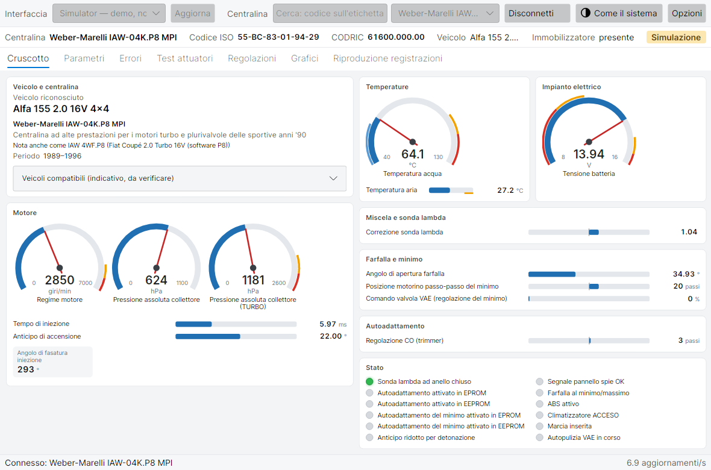

# marelli-iaw-ecu-studio

Diagnosi per le centraline motore Magneti Marelli IAW delle FIAT, Lancia e Alfa Romeo degli anni '90 (OBD-I, connettore FIAT a 3 pin). Evoluzione multipiattaforma di [IES2 (IAW Scan 2)](https://github.com/TzOk83/IES2) di Tomasz Orczyk, la cui ultima versione (0.86) risale al 2020.

[Read in English](README.md)

> **Stato: sviluppo iniziale, non ancora provato su un'auto reale.** L'applicazione desktop, lo strumento a riga di comando, il nucleo del protocollo e le definizioni funzionano con il simulatore integrato e sono verificati contro il codice originale di IES2. L'applicazione Windows originale è conservata in `legacy/IES2`.



## Funzioni

- Riconoscimento automatico della centralina, codici ISO e CODRIC, modello di veicolo, immobilizzatore
- Ricerca della centralina per codice sull'etichetta (ad esempio IAW 4WF.P8), per auto o per marca
- Cruscotto organizzato per impianto (motore, temperature, impianto elettrico, miscela, minimo, autoadattamento, stato) con strumenti circolari, barre con zone di allarme e spie
- Scheda veicolo: auto riconosciuta, tecnologia e periodo della centralina, veicoli compatibili
- Tabella dei parametri in tempo reale, raggruppata, con la frequenza di aggiornamento effettiva
- Errori motore e immobilizzatore, cancellazione errori
- Test attuatori e regolazioni, ciascuno con conferma
- Grafici interattivi: zoom, spostamento, una scala per segnale, finestra temporale
- Registrazione CSV e riproduzione dei log (anche quelli esportati da IES2) con play, pausa, barra di scorrimento e velocità 1x/2x/5x/10x
- Trace della linea: ogni byte sulla K-Line salvato in un file di testo, per segnalare i problemi; `iaw-cli trace` ne fa il riepilogo
- Riproduzione dei trace: una sessione registrata risponde al posto dell'auto, per i test di regressione o per provare il programma con valori reali
- Riconnessione automatica dopo una perdita di comunicazione (quadro spento e riacceso, connettore che balla), con la causa più probabile: nessuna eco dall'adattatore, eco errata, o centralina che non risponde
- Bridge di rete (RFC 2217): `iaw-cli bridge` trasforma un Raspberry Pi con il cavo in un'interfaccia Wi-Fi; dovrebbero funzionare anche ser2net ed esp-link
- OBD-II / EOBD con lo stesso cavo K-Line per le auto dal 2001: ISO 9141-2 e KWP2000 (init a 5 baud e fast init), dati in tempo reale standard, errori memorizzati e in attesa, VIN (`iaw-cli obd`, per ora solo da riga di comando)
- Librerie su NuGet per altri programmi: protocollo, definizioni, trasporti, simulatore
- Simulatore integrato per provare tutto senza auto
- Si apre massimizzata la prima volta, poi come l'avete lasciata. Layout che si adatta alla finestra: cruscotto e tabella dei parametri si ingrandiscono o si riducono per stare nello schermo senza scroll, fino a una dimensione che resta leggibile; su uno schermo largo i parametri si dispongono su più colonne
- Tema chiaro e scuro, che di default segue quello del sistema operativo; il menu del tema accanto a Opzioni (e le Opzioni stesse) sceglie tra sistema, chiaro e scuro
- Windows, Linux (anche Raspberry Pi) e macOS; interfaccia in italiano e inglese, nomi di parametri ed errori in dieci lingue

| Scheda veicolo | Grafici | Riproduzione log |
| --- | --- | --- |
|  |  |  |


## Centraline supportate

| Famiglia | Vetture (esempi) |
| --- | --- |
| IAW-6F/16F SPI | Cinquecento, Seicento, Panda, Punto 55/60, Tipo/Tempra 1.6, Lancia Y 1.2 |
| IAW-8F/18F MPI | Punto 75 1.2, Palio 1.2, Delta/Dedra 1.8, Alfa 145/146 1.3 Boxer, Tipo/Tempra 1.8 |
| IAW-8F.68 MPI | Alfa 33 1.4 |
| IAW-18FD/1G7 MPI | Punto 1.2 16V, Siena 1.4, Palio 1.0 |
| Weber-Marelli IAW-04K.P8 MPI (anche IAW 4WF.P8) | Coupé 2.0 Turbo 16V, Delta Evoluzione, Dedra/Tempra 2.0, Tipo 2000 16V, Alfa 155 2.0 16V |
| Immobilizzatore FIAT CODE | tutte le precedenti, se presente |

`iaw-cli ecus` mostra l'elenco completo con i codici ISO, gli altri nomi delle centraline e i veicoli compatibili indicativi; `--ecu` accetta anche un codice etichetta come `4WF.P8`. Le definizioni sono file JSON in [`src/MarelliIawEcuStudio.Core/Definitions`](src/MarelliIawEcuStudio.Core/Definitions); per correggerne o aggiungerne una vedi [docs/definitions.md](docs/definitions.md).

## Hardware

Un cavo USB VAG-COM "KKL 409.1" con chip FTDI originale, più un adattatore da OBD2 a FIAT 3 pin. Dettagli, permessi su Linux e latenza: [docs/hardware.md](docs/hardware.md).

Queste centraline **non** usano ISO 9141-2 né KWP2000, ma un protocollo FIAT con init a 1200 baud e richieste di un byte a 7680 baud. Gli adattatori ELM327 non possono gestirlo.

## Avvio rapido

Serve il [.NET 10 SDK](https://dotnet.microsoft.com/download).

```sh
dotnet build
dotnet test

# Applicazione desktop (scegli "Simulatore" come interfaccia per provarla senza auto)
dotnet run --project src/MarelliIawEcuStudio.App

# Riga di comando, anche senza auto
dotnet run --project src/MarelliIawEcuStudio.Cli -- read --simulate --count 5 --lang it

# Con il cavo (esempio Linux; su Windows --port COM3)
dotnet run --project src/MarelliIawEcuStudio.Cli -- ports
dotnet run --project src/MarelliIawEcuStudio.Cli -- identify --port /dev/ttyUSB0
dotnet run --project src/MarelliIawEcuStudio.Cli -- read --port /dev/ttyUSB0 --params PERIODE,MT_EAU_L --count 0 --csv giro.csv
dotnet run --project src/MarelliIawEcuStudio.Cli -- errors --port /dev/ttyUSB0

# Salva un trace della linea, guardalo, riproducilo senza auto
dotnet run --project src/MarelliIawEcuStudio.Cli -- read --port /dev/ttyUSB0 --count 20 --trace punto.trace.txt
dotnet run --project src/MarelliIawEcuStudio.Cli -- trace punto.trace.txt
dotnet run --project src/MarelliIawEcuStudio.Cli -- read --replay punto.trace.txt --count 20

# Attraverso un bridge di rete (sul Pi in auto: iaw-cli bridge --port /dev/ttyUSB0 --listen 0.0.0.0:2217)
dotnet run --project src/MarelliIawEcuStudio.Cli -- read --port rfc2217://192.168.4.1:2217

# Auto OBD-II (dal 2001), oppure --simulate kwp-fast senza auto
dotnet run --project src/MarelliIawEcuStudio.Cli -- obd read --port /dev/ttyUSB0 --params RPM,ECT,MAP --lang it
dotnet run --project src/MarelliIawEcuStudio.Cli -- obd dtc --port /dev/ttyUSB0
```

Gli eseguibili pronti per Windows, Linux x64, Linux arm64 (Raspberry Pi) e macOS sono allegati a ogni [release](https://github.com/emanuelemerlo/marelli-iaw-ecu-studio/releases); la CI li produce anche a ogni modifica (GitHub Actions → artifacts).

Come IES2, il programma ascolta per 10 secondi il codice ISO che la centralina può inviare all'accensione: avvialo, poi gira la chiave. Per saltare l'attesa togli la spunta "Attendi il codice ISO all'accensione" nelle Opzioni, o usa `--no-broadcast` da riga di comando.

## Sicurezza

Test attuatori, cancellazione errori e regolazioni comandano componenti reali (pompa, iniettori, bobine). L'applicazione chiede conferma prima di ciascuno e permette di disattivarli nelle Opzioni; lo strumento a riga di comando è **in sola lettura** senza `--allow-active`, e chiede anch'esso conferma. Le definizioni non marcate `verified` non eseguono comandi attivi salvo autorizzazione esplicita. Uso a proprio rischio; vedi l'esclusione di garanzia nella licenza.

## Librerie

Le quattro librerie (Core, i due trasporti, Simulator) sono pubblicate come pacchetti NuGet: esempi in [src/PACKAGE.md](src/PACKAGE.md).

## Contribuire

L'aiuto più utile adesso sono le prove su auto vere: lancia `identify`, `read` ed `errors` con `--trace` e apri un [real car report](https://github.com/emanuelemerlo/marelli-iaw-ecu-studio/issues/new?template=car_report.yml) (va bene anche in italiano). Per codice, definizioni e traduzioni vedi [CONTRIBUTING.md](CONTRIBUTING.md) (in inglese); per chiedere aiuto [SUPPORT.md](SUPPORT.md); per problemi di sicurezza [SECURITY.md](SECURITY.md). Chi partecipa segue il [Codice di condotta](CODE_OF_CONDUCT.md).

## Origine e licenza

Il progetto prosegue IES2 di Tomasz Orczyk e ne conserva tutta la storia. Il codice è rilasciato sotto [GNU GPL v3](LICENSE). Le parti derivate da IES2 restano anche sotto la sua licenza BSD 3-clausole ([LICENSE-IES2](LICENSE-IES2)); attribuzioni, traduttori e marchi in [NOTICE](NOTICE). Progetto non affiliato a Marelli, FIAT o ai loro successori.
