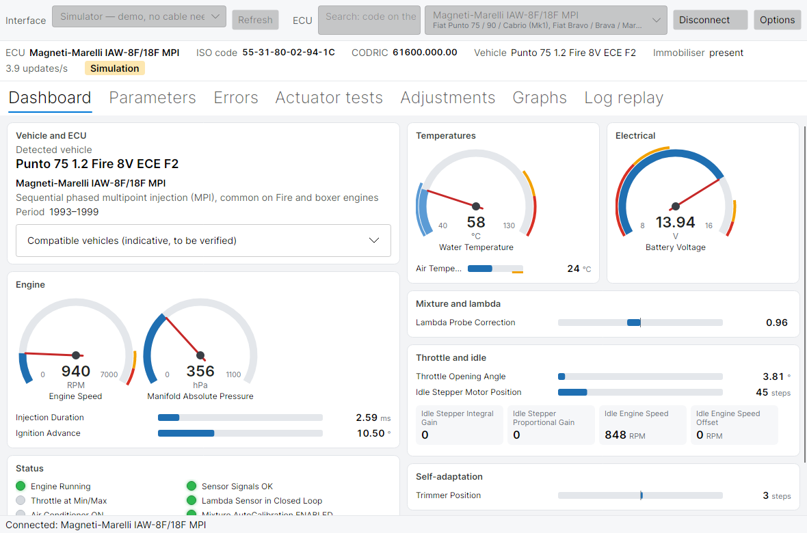
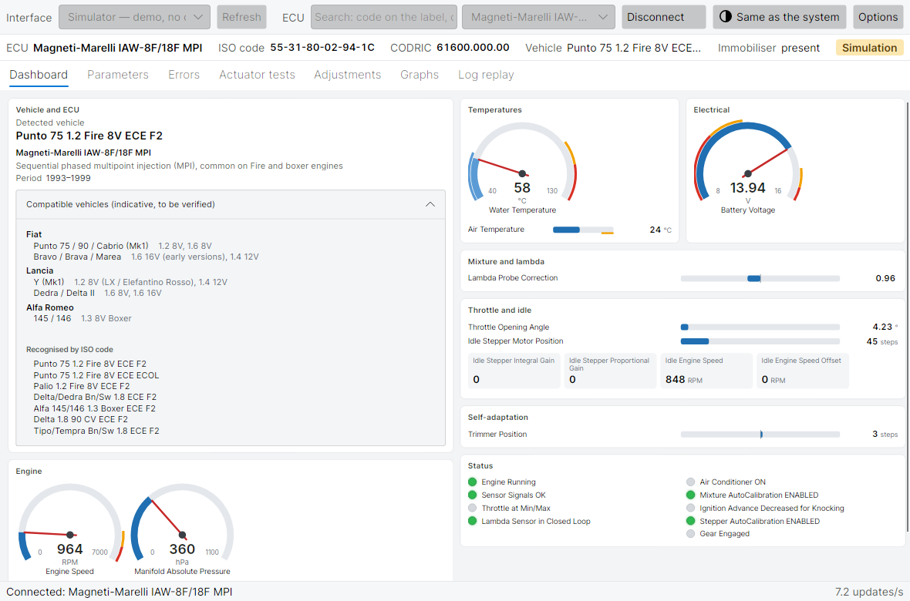
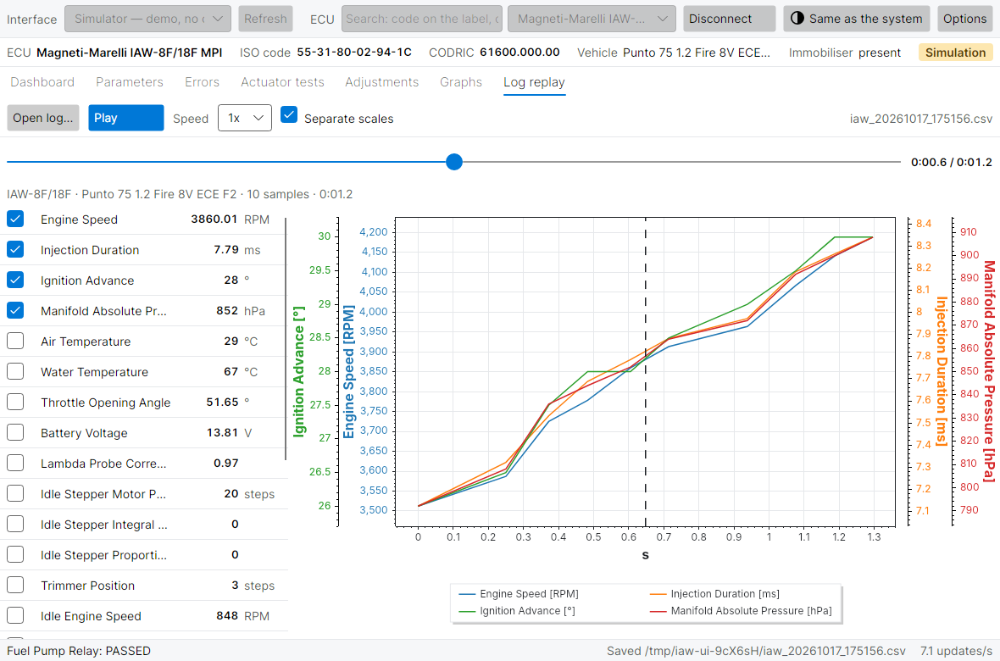
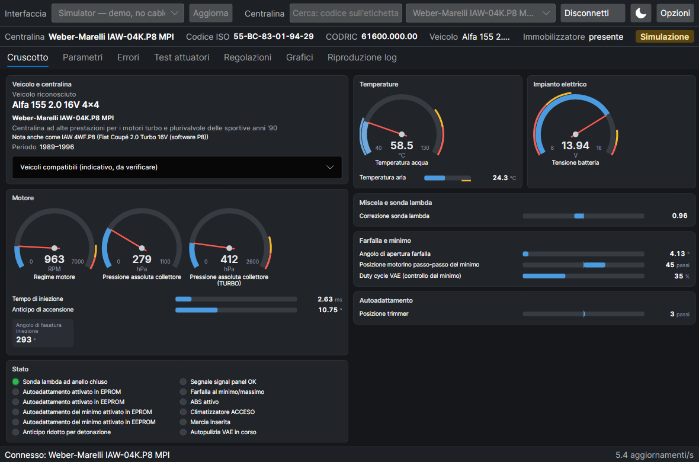

# marelli-iaw-ecu-studio

Diagnostics for the Magneti Marelli IAW engine control units of 1990s FIAT, Lancia and Alfa Romeo cars (OBD-I, FIAT 3-pin connector). Cross-platform evolution of [IES2 (IAW Scan 2)](https://github.com/TzOk83/IES2) by Tomasz Orczyk, whose last release (0.86) dates from 2020.

[Leggi in italiano](README.it.md)

> **Status: early development, not yet tested on a real car.** The desktop application, the command line tool, the protocol core and the ECU definitions work against the built-in simulator and are checked against the original IES2 code. The original Windows application is kept in `legacy/IES2`.



**[User manual](docs/manual/en/README.md)**: installation, every screen and action of the application, the command line tool, troubleshooting and a reference of each ECU.

## Features

- Automatic ECU detection, ISO and CODRIC codes, vehicle model, immobiliser
- ECU search by the code on its label (for example IAW 4WF.P8), by car or by brand
- Dashboard grouped by system (engine, temperatures, electrical, mixture, idle, self-adaptation, status) with round gauges, bars with warning zones and status lights
- Vehicle card: detected car, ECU technology and period, compatible vehicles
- Live parameters table, grouped, with the real refresh rate shown
- Engine and immobiliser errors, clear codes
- Actuator tests and adjustments, each with a confirmation
- Interactive graphs: zoom, pan, one scale per signal, time window
- CSV recording, and replay of recorded logs (also IES2 exports) with play, pause, scrubbing and 1x/2x/5x/10x speed
- Line trace: every byte on the K-Line saved to a text file, to report problems; `iaw-cli trace` summarises it
- Trace replay: a recorded session answers in place of the car, for regression tests or to try the software with real values
- Automatic reconnection after a communication loss (ignition cycled, loose connector), with the likely cause of the loss: no echo from the adapter, wrong echo, or no answer from the ECU
- Network bridge (RFC 2217): `iaw-cli bridge` turns a Raspberry Pi with the cable into a Wi-Fi adapter; ser2net and esp-link should work too
- OBD-II / EOBD over the same K-Line cable for cars of 2001 and later: ISO 9141-2 and KWP2000 (5-baud and fast init), standard live data, stored and pending trouble codes, VIN (`iaw-cli obd`, command line only for now)
- Libraries on NuGet for other programs: protocol, definitions, transports, simulator
- Built-in simulator to try everything without a car
- Opens maximised the first time, then as you left it. Layout that adapts to the window: the dashboard and the parameter table grow or shrink to fit the screen without scrolling, down to a size that stays readable; parameters spread over several columns on a wide screen
- Light and dark theme, following the operating system by default; the theme menu next to Options (and Options itself) chooses system, light or dark
- Windows, Linux (including Raspberry Pi) and macOS; interface in English and Italian, parameter and error names in ten languages

| Vehicle card | Graphs | Log replay |
| --- | --- | --- |
|  |  |  |



## Supported ECUs

| Family | Vehicles (examples) |
| --- | --- |
| IAW-6F/16F SPI | Cinquecento, Seicento, Panda, Punto 55/60, Tipo/Tempra 1.6, Lancia Y 1.2 |
| IAW-8F/18F MPI | Punto 75 1.2, Palio 1.2, Delta/Dedra 1.8, Alfa 145/146 1.3 Boxer, Tipo/Tempra 1.8 |
| IAW-8F.68 MPI | Alfa 33 1.4 |
| IAW-18FD/1G7 MPI | Punto 1.2 16V, Siena 1.4, Palio 1.0 |
| Weber-Marelli IAW-04K.P8 MPI (also IAW 4WF.P8) | Coupé 2.0 Turbo 16V, Delta Evoluzione, Dedra/Tempra 2.0, Tipo 2000 16V, Alfa 155 2.0 16V |
| FIAT CODE immobiliser | all of the above, when fitted |

Run `iaw-cli ecus` for the full list with ISO codes, other names of the units and indicative compatible vehicles; `--ecu` also accepts a label code such as `4WF.P8`. The definitions are JSON files in [`src/MarelliIawEcuStudio.Core/Definitions`](src/MarelliIawEcuStudio.Core/Definitions); see [docs/definitions.md](docs/definitions.md) to correct or add one.

## Hardware

A VAG-COM "KKL 409.1" USB cable with a genuine FTDI chip, plus an OBD2 to FIAT 3-pin adapter. Details, Linux permissions and latency tuning: [docs/hardware.md](docs/hardware.md).

These ECUs do **not** speak ISO 9141-2 or KWP2000: they use a FIAT protocol with a 1200 baud init and single-byte requests at 7680 baud. ELM327 adapters cannot do this.

## Quick start

Requires the [.NET 10 SDK](https://dotnet.microsoft.com/download).

```sh
dotnet build
dotnet test

# Desktop application (choose "Simulator" as interface to try it without a car)
dotnet run --project src/MarelliIawEcuStudio.App

# Command line, also without a car
dotnet run --project src/MarelliIawEcuStudio.Cli -- read --simulate --count 5

# With the cable (Linux example; on Windows use --port COM3)
dotnet run --project src/MarelliIawEcuStudio.Cli -- ports
dotnet run --project src/MarelliIawEcuStudio.Cli -- identify --port /dev/ttyUSB0
dotnet run --project src/MarelliIawEcuStudio.Cli -- read --port /dev/ttyUSB0 --params PERIODE,MT_EAU_L --count 0 --csv drive.csv
dotnet run --project src/MarelliIawEcuStudio.Cli -- errors --port /dev/ttyUSB0

# Save a line trace, look at it, replay it without the car
dotnet run --project src/MarelliIawEcuStudio.Cli -- read --port /dev/ttyUSB0 --count 20 --trace punto.trace.txt
dotnet run --project src/MarelliIawEcuStudio.Cli -- trace punto.trace.txt
dotnet run --project src/MarelliIawEcuStudio.Cli -- read --replay punto.trace.txt --count 20

# Through a network bridge (on the Pi in the car: iaw-cli bridge --port /dev/ttyUSB0 --listen 0.0.0.0:2217)
dotnet run --project src/MarelliIawEcuStudio.Cli -- read --port rfc2217://192.168.4.1:2217

# OBD-II car (2001 and later), or --simulate kwp-fast without a car
dotnet run --project src/MarelliIawEcuStudio.Cli -- obd read --port /dev/ttyUSB0 --params RPM,ECT,MAP
dotnet run --project src/MarelliIawEcuStudio.Cli -- obd dtc --port /dev/ttyUSB0
```

Ready-made executables for Windows, Linux x64, Linux arm64 (Raspberry Pi) and macOS are attached to each [release](https://github.com/emanuelemerlo/marelli-iaw-ecu-studio/releases); the CI also builds them on every change (GitHub Actions → artifacts).

Like IES2, the software first listens up to 10 seconds for an ISO code the ECU may send at key-on: start it, then turn the ignition on. In the application, untick "Wait for the ISO code at key-on" in Options to skip the wait; on the command line use `--no-broadcast` (and `--lang it` for Italian names).

## Safety

Actuator tests, clear codes and adjustments drive real components (fuel pump, injectors, coils). The application asks for confirmation before each one and lets you disable them in Options; the command line tool is **read only** unless you pass `--allow-active`, and asks for confirmation too. Definitions not marked `verified` never run active commands unless explicitly allowed. Use at your own risk; see the warranty disclaimer in the license.

## Repository layout

| Path | Content |
| --- | --- |
| `src/MarelliIawEcuStudio.Core` | IAW protocol, ECU definitions, decoding, diagnostic session, line traces, CSV logs; framed K-Line (ISO 9141-2, KWP2000) and OBD-II. No UI. |
| `src/MarelliIawEcuStudio.Transport.Serial` | Serial transport and port discovery for Windows, Linux, macOS |
| `src/MarelliIawEcuStudio.Transport.Network` | RFC 2217 network transport and bridge server |
| `src/MarelliIawEcuStudio.Simulator` | Simulated IAW ECUs (driven by the same definitions), simulated OBD cars, trace replay |
| `src/MarelliIawEcuStudio.Presentation` | View models (MVVM) of the application, without UI framework dependencies |
| `src/MarelliIawEcuStudio.App` | Desktop application (Avalonia, ScottPlot) |
| `src/MarelliIawEcuStudio.Cli` | `iaw-cli` command line tool |
| `tests/MarelliIawEcuStudio.Tests` | Unit, simulator, view model and equivalence tests; the latter compile the original IES2 modules and compare every table and every decoded value |
| `tests/MarelliIawEcuStudio.App.Tests` | The real window rendered headless against the simulator; produces the screenshots |
| `legacy/IES2` | Original IES2 source, unchanged, kept as reference |
| `tools/generate-definitions` | Script that generated the JSON definitions from the IES2 source |
| `schemas/` | JSON Schema for definition files |

The four libraries (Core, the two transports, Simulator) are published as NuGet packages: see [src/PACKAGE.md](src/PACKAGE.md) for examples.

## Contributing

Sessions on real cars are the most useful help right now: run `identify`, `read` and `errors` with `--trace` and open a [real car report](https://github.com/emanuelemerlo/marelli-iaw-ecu-studio/issues/new?template=car_report.yml). For code, definitions and translations see [CONTRIBUTING.md](CONTRIBUTING.md); for help, [SUPPORT.md](SUPPORT.md); for security problems, [SECURITY.md](SECURITY.md). Everyone taking part follows the [Code of Conduct](CODE_OF_CONDUCT.md).

## Origin and license

This project continues IES2 by Tomasz Orczyk, keeping its full history. The code is released under the [GNU GPL v3](LICENSE). Parts derived from IES2 remain also under its BSD 3-Clause license ([LICENSE-IES2](LICENSE-IES2)); see [NOTICE](NOTICE) for attribution, translator credits and trademarks. Not affiliated with Marelli, FIAT or their successors.
