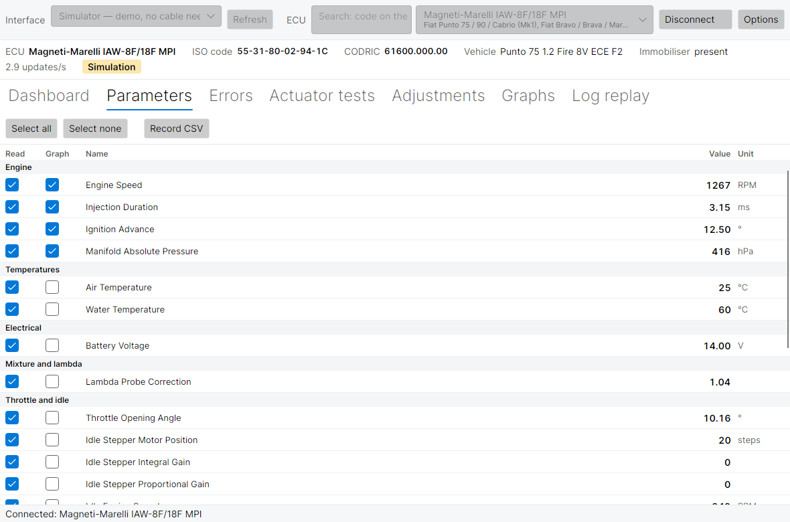

# Parameters and CSV recording

[← Manual](README.md) · Previous: [Dashboard](dashboard.md) · Next: [Errors →](errors.md)

The **Parameters** tab lists every live value of the connected ECU in a table, grouped like the dashboard. Here you choose what to read, what to plot, and you start a recording.



## The table

| Column | Meaning |
| --- | --- |
| **Read** | Ticked: the value is requested from the ECU at each cycle. Unticked: it is skipped, and the remaining values refresh faster. |
| **Graph** | Ticked: the value is drawn in the [Graphs](graphs.md) tab. The first four parameters (engine speed, injection, advance, manifold pressure on most ECUs) are ticked when you connect. |
| Name | Name of the parameter in the language chosen in [Options](options.md). Hover over a cut name to read it in full. |
| **Value** | Last value read. **#ERR** in red: the value could not be decoded. Status values show **YES** / **NO**. |
| **Unit** | rpm, ms, °, hPa, °C, V, steps… |

**Select all** and **Select none** tick or untick the whole **Read** column.

On a wide screen the groups spread over two or three columns; the group title doubles as the column header.

### How fast are the values updated?

The ECU answers one byte per request at 7680 baud, so each value costs a few milliseconds. The real rate is shown at the right of the status bar (for example *6.8 updates/s*). To make it faster:

- untick in **Read** what you do not need (status lights and self-adaptation values change rarely);
- untick **Read errors** in the [Errors](errors.md) tab when you are not looking at errors;
- set the FTDI latency timer to 1 ms ([Hardware](../../hardware.md)).

The parameter IDs (`PERIODE`, `MT_EAU_L`…) and the meaning of each value are listed in the [ECU reference](ecu-reference.md) and in the [Glossary](glossary.md).

## Recording a CSV log

1. Connect, and tick in **Read** the parameters to record.
2. Click **Record CSV** (here or in the Graphs tab). The status bar shows *Recording to …* with the file path.
3. Drive, or run the test you want to document.
4. Click **Stop recording**. The status bar shows *Saved …*.

Notes:

- The file is called `iaw_<date>_<time>.csv` and goes into the log folder set in [Options](options.md#files-and-folders) (by default `Documents/marelli-iaw-ecu-studio/logs`).
- The columns are the parameters ticked in **Read** when the recording starts. While recording they keep being read even if you untick them, so the file never repeats old values.
- Recording stops by itself when you disconnect.
- **Record CSV** is available only while connected and with at least one parameter ticked.

### The CSV format

The file opens in Excel, LibreOffice Calc or any text editor:

```text
# marelli-iaw-ecu-studio log v1
# ecu=IAW-6F/16F
# iso=55D085029440
# columns=PERIODE;MT_EAU_L
# units=rpm;°C
Time [ms];Engine speed [rpm];Coolant temperature [°C]
0;850;88
```

- The lines starting with `#` say which ECU and car the log comes from, so it can be [replayed](log-replay.md) later.
- Columns are separated by `;` as in IES2, and numbers always use the point as decimal separator, whatever the language. In a spreadsheet, choose `;` as separator and `.` as decimal separator when importing.
- **Time [ms]** counts milliseconds from the start of the recording.

To look at a recording, open it in [Log replay](log-replay.md).
