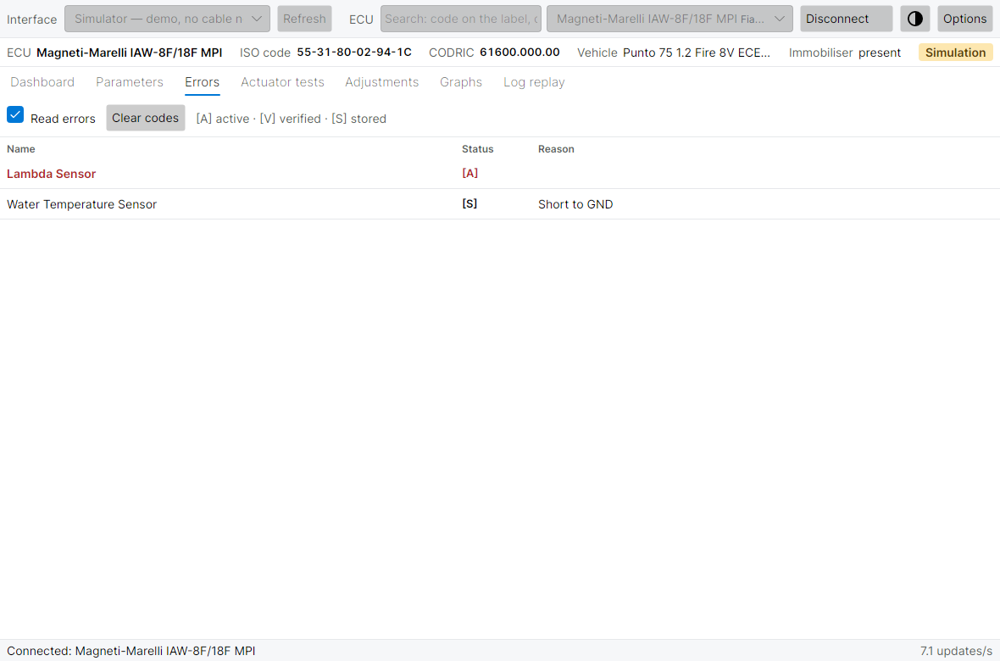

# Errori

[← Manuale](README.md) · Precedente: [Parametri](parameters.md) · Successivo: [Test attuatori e regolazioni →](tests-and-adjustments.md)

La scheda **Errori** elenca i guasti che la centralina ha rilevato su sensori, attuatori e circuiti interni, e quelli dell'immobilizzatore FIAT CODE quando l'auto lo ha.

## Lettura degli errori

Con **Leggi errori** spuntato (impostazione predefinita) il programma legge i registri degli errori ogni cinque cicli, tra una lettura dei parametri e l'altra. Compaiono solo gli errori presenti; se non ce ne sono la scheda dice *Nessun errore*. Togliendo la spunta a **Leggi errori** i parametri si aggiornano un po' più in fretta.

| Colonna | Significato |
| --- | --- |
| **Nome** | Il componente o la funzione in avaria: potenziometro farfalla, sensore MAP, sonda lambda, sensore temperatura acqua, iniettore, bobina, stepper minimo, elettrovalvola canister, RAM/ROM/EEPROM… L'elenco completo per ogni centralina è nel [Riferimento centraline](ecu-reference.md). |
| **Stato** | Una o più lettere, vedi sotto. |
| **Causa** | Il perché, quando la centralina lo dice: *Corto a massa*, *Corto a +Vcc*, *Circuito aperto*, *Corto a massa o circuito aperto*, *Oltre il massimo*, *Sotto il minimo*, *Miscela ricca al limite*, *Miscela magra al limite*, *Troppa aria*, *Aria insufficiente*… |

### Lettere di stato

| Lettera | Nome | Significato |
| --- | --- | --- |
| **[A]** | attivo | Il guasto è presente **adesso**. La riga è in rosso. |
| **[V]** | verificato | La centralina ha confermato il guasto (non disponibile su tutte le famiglie). |
| **[S]** | memorizzato | Il guasto è nella memoria della centralina: si è verificato in passato, e potrebbe non esserci più. |

Le lettere si combinano: **[A][S]** è un guasto presente adesso e già memorizzato; **[S]** da solo è un guasto passato, per esempio un connettore staccato con la chiave su MAR.

### Errori dell'immobilizzatore

Quando la barra centralina mostra *Immobilizzatore: presente*, l'elenco comprende anche gli errori del FIAT CODE: centralina non sincronizzata con il CODE, avviamento inibito, errore codice chiave, codice errato o non riconosciuto, codice non ricevuto… Aiutano con un'auto che gira col motorino ma non parte.

## Cancellazione errori

**Cancella errori** cancella gli errori memorizzati nella centralina.

1. Chiave **su MAR**, motore **spento**.
2. Fate clic su **Cancella errori** e confermate.
3. La barra di stato mostra l'esito: **OK**, **NON RIUSCITO**, **TIMEOUT**…

Da sapere:

- Serve **Abilita comandi attivi** nelle [Opzioni](options.md); altrimenti il programma lo dice e non fa nulla.
- Cancellate gli errori solo dopo averne eliminato la causa e averli annotati (basta uno screenshot): un guasto attivo ricompare subito.
- L'azzeramento degli autoadattivi è un comando a parte, nelle [Regolazioni](tests-and-adjustments.md#regolazioni).

## Una procedura di diagnosi

1. Connettetevi a motore spento e annotate gli errori.
2. Cancellate gli errori, poi avviate il motore e lasciatelo al minimo.
3. Gli errori che ricompaiono con **[A]** sono guasti presenti: controllate cablaggio e componente. Quelli che non tornano erano intermittenti o dovuti a lavori fatti in passato sull'auto.
4. Per trovare i guasti intermittenti guardate la scheda mentre muovete connettori e cablaggi a motore acceso.
