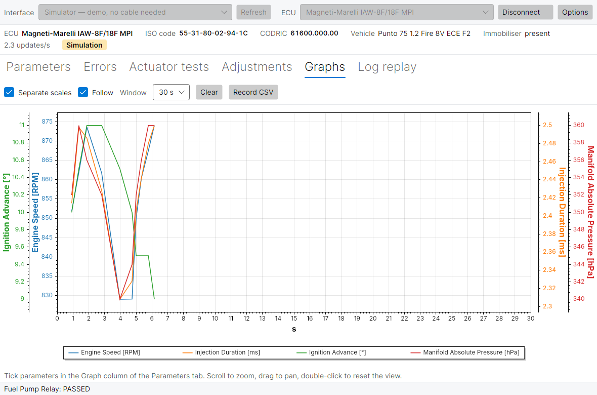

# Grafici

[← Manuale](README.md) · Precedente: [Test attuatori e regolazioni](tests-and-adjustments.md) · Successivo: [Riproduzione log →](log-replay.md)

La scheda **Grafici** disegna nel tempo i parametri scelti mentre si è connessi: utile per vedere come si stabilizza il minimo, come oscilla la correzione lambda, o cosa succede quando compare un guasto.

## Scegliere cosa disegnare

Spuntate i parametri nella colonna **Grafico** della scheda [Parametri](parameters.md). Alla connessione i primi quattro (giri, tempo di iniezione, anticipo, pressione collettore sulla maggior parte delle centraline) sono già spuntati. Un parametro in grafico deve essere spuntato anche in **Leggi**, altrimenti non riceve nuovi punti.

Ogni segnale ha il suo colore e il suo nome nella legenda sotto il grafico.

## Barra degli strumenti

| Comando | Cosa fa |
| --- | --- |
| **Scale separate** | Spuntato: ogni segnale ha il suo asse verticale, alternativamente a sinistra e a destra, così si leggono insieme i giri (migliaia) e la correzione lambda (intorno a 1). Non spuntato: un asse comune, per confrontare segnali con la stessa unità. |
| **Segui** | Spuntato: il grafico scorre per mostrare gli ultimi valori. Toglietelo per fermarvi su un momento passato mentre i dati continuano ad arrivare. |
| **Finestra** | Quanti secondi si vedono seguendo i dati: 10, 30, 60 o 300 s, oppure **Tutto** per vedere l'intera sessione. |
| **Pulisci** | Cancella le curve e ricomincia da adesso. |
| **Registra CSV** | Avvia o ferma una [registrazione CSV](parameters.md#registrare-un-log-csv), lo stesso pulsante della scheda Parametri. |

## Mouse

- **Rotella**: ingrandisce e riduce.
- **Trascinare**: sposta la vista.
- **Doppio clic**: torna alla vista automatica.

## Da sapere

- Il grafico tiene gli ultimi 36.000 punti di ogni segnale (circa un'ora e mezza a 7 aggiornamenti al secondo); i più vecchi vengono scartati. Per conservare una sessione [registratela](parameters.md#registrare-un-log-csv).
- Il grafico riparte da zero a ogni nuova connessione.
- Scale separate e finestra temporale vengono ricordate al prossimo avvio.
